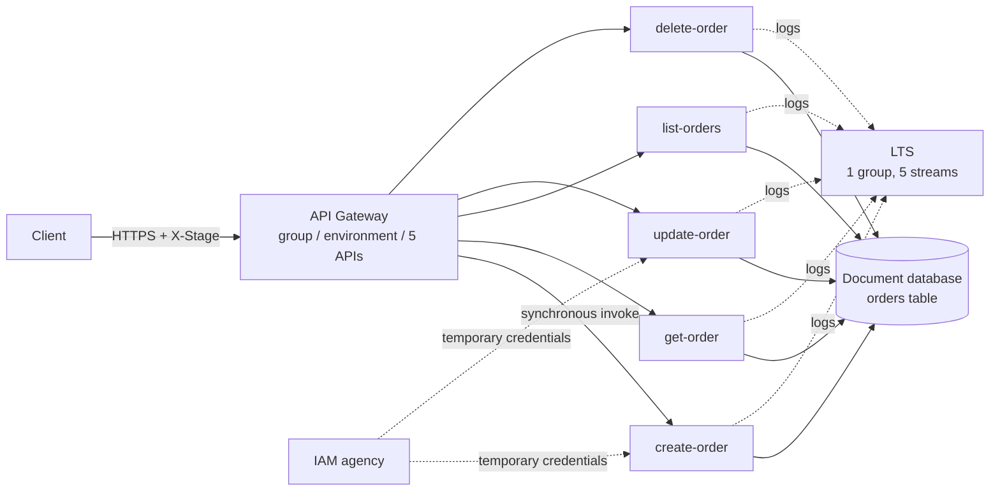

# Order REST API on FunctionGraph and API Gateway

[](LICENSE)
[](https://www.huaweicloud.com)

Five serverless functions handle order creation, retrieval, listing, update and deletion, exposed as
a REST API through a dedicated API Gateway instance. Orders live in a document database reachable
through its compatible interface. It suits teams that need a working order API skeleton without
building a service framework and operating long-running processes.

## Overview

An order API looks simple — create, read, update, delete — but shipping it means solving four
separate problems: request routing and environment switching, function cold start and sizing,
data consistency, and log-based troubleshooting. This sample turns each into a reusable piece:

- **Ingress** — one API Gateway group, one environment, five APIs and five publications, all
  declared. Non-production environments are selected with the `X-Stage` header instead of code
  changes.
- **Compute** — five functions share a single deployment package and differ only by entry point.
  They run at 128 MB and a 15-second timeout, which is enough for order I/O.
- **Data** — one table holds orders, keyed by order identifier. Updates use a version number for
  optimistic concurrency; a stale version or a missing order returns 409.
- **Observability** — an explicit log group and five log streams, with all four log parameters
  bound on every function. Miss one and the platform will not create the group, so logs are
  silently lost.

**What it solves**: it collapses "order API from zero to verified" into one deployment while
keeping the interface boundaries needed for later extension.

**Who it is for**: teams that need to deliver an order REST API quickly, and teams replacing a
long-running service process with a serverless form while still requiring complete API semantics
(status codes, pagination, concurrency control).

## Table of Contents

- [Architecture](#architecture)
- [Highlights](#highlights)
- [Cloud Services](#cloud-services)
- [Prerequisites](#prerequisites)
- [Quick Start](#quick-start)
- [Step-by-step Deployment](#step-by-step-deployment)
- [Usage and Verification](#usage-and-verification)
- [Repository Layout](#repository-layout)
- [Clean Up](#clean-up)
- [Further Reading](#further-reading)
- [FAQ](#faq)
- [License](#license)
- [Contact](#contact)

## Architecture



All five functions share one deployment package and differ only by entry point. The orders table is
created during apply; on destroy the deletion is limited to tables carrying this project's prefix.

| Layer | Service | Description |
|-|-|-|
| Ingress | API Gateway dedicated instance | Group + environment + 5 APIs + publications, function backend, synchronous invocation |
| Compute | FunctionGraph | 5 Java 11 functions, 128 MB / 15 s, ZIP package |
| Data | Document database (compatible interface) | Called from the functions with the JSON protocol and request signing |
| Observability | LTS | Explicit log group with one stream per function, all four parameters bound |
| Permissions | IAM agency | Trusts the cloud service identity, least-privilege system roles |

## Highlights

- **Complete API semantics** — creation returns 201 with version 1; listing is cursor-paginated at
  10 items per page; updates validate the version number and return 409 on mismatch; deletion
  returns the removed order; a missing order returns 404.
- **One package, five entry points** — the five actions share models, the data layer and the error
  mapping. There is a single deployment package; entry points differ by fully qualified class name.
- **Deterministic build** — compilation uses `javac --release 11`, and packaging pins entry
  timestamps and permissions, so two builds of the same source produce the same digest.
- **Logs are never dropped** — the group and streams are created explicitly and all four
  parameters (group ID, group name, stream ID, stream name) are bound on each function.
- **Bounded destroy** — table creation and deletion both run through a script, limited to tables
  with this project's prefix, so data from other projects on the same instance is untouched.
- **Package self-checks** — the build script verifies entry classes are present, compile-time
  stubs are excluded, and the outer ZIP root holds only `function.jar`.

## Cloud Services

| Service | Role in this sample | Terraform resource |
|-|-|-|
| FunctionGraph | Hosts the five order functions | `huaweicloud_fgs_function` |
| API Gateway | Group, environment, five APIs and publications | `huaweicloud_apig_group`, `huaweicloud_apig_environment`, `huaweicloud_apig_api`, `huaweicloud_apig_api_publishment` |
| LTS | One log group and five log streams | `huaweicloud_lts_group`, `huaweicloud_lts_stream` |
| IAM | Agency used by the functions | `huaweicloud_identity_agency` |
| Document database (compatible interface) | Order persistence | Created by `terraform_data` invoking the table script; no declarative resource |

Release these resources when the sample is no longer needed, to avoid leaving them behind.

## Prerequisites

**Account and permissions**

- An account that has completed real-name verification, with `cn-north-4` available (this sample
  was verified there).
- Permission to enable and operate FunctionGraph, API Gateway, LTS and IAM.
- Permission to create an agency: it grants roles to a cloud service identity at project scope.
- Access Key ID and Secret Access Key from the "My Credentials" page, supplied to the deployment
  shell. Never write credentials into code or commit them.

**External resources already in place**

- An API Gateway dedicated instance (Basic edition or above) and its instance ID.
- A document database instance whose data plane is reachable from the functions, plus an access
  key that can reach its compatible interface.
- If the data plane is a private address, the network and subnet identifiers, so the functions can
  be attached to it.

**Tools and versions**

- Terraform CLI `>= 1.3`, huaweicloud provider `>= 1.64`.
- JDK 11 or later to compile the functions, Python 3.8 or later for the build and verification
  scripts.

**Region and naming constraints**

- `var.region` defaults to `cn-north-4`. The signing region for the data plane can be set
  separately and falls back to the deployment region when left empty.
- `var.app_name` derives every resource name: it must start with a letter, may contain digits and
  hyphens, and is 3 to 31 characters long.
- The environment name must match the `X-Stage` header value. A non-RELEASE environment without
  that header returns 404.

## Quick Start

Run these in order for a complete deployment; the next section explains each step.

```bash
# 1. Build the deployment package (offline, no cloud calls)
python src/scripts/build.py

# 2. Local checks
python src/scripts/run_tests.py
cd infra && terraform init && terraform validate && cd ..

# 3. Supply deployment values and create resources
cd infra
export HW_ACCESS_KEY=<HW_ACCESS_KEY>
export HW_SECRET_KEY=<HW_SECRET_KEY>
export TF_VAR_apig_instance_id="<API Gateway dedicated instance ID>"
export TF_VAR_gemini_db_endpoint="<data plane address>"
export TF_VAR_gemini_access_key="<data plane access key ID>"
export TF_VAR_gemini_secret_key="<data plane secret access key>"
terraform plan -out=jora.tfplan
terraform apply jora.tfplan

# 4. Verify
cd ..
python src/scripts/verify_e2e.py
```

## Step-by-step Deployment

### Step 1: Build the deployment package

```bash
python src/scripts/build.py
```

Expected output:

```text
[PASS] Java 11 compile done, compile-time Context stub excluded
[PASS] function.zip root holds only function.jar
[PASS] function.zip sha256=82b724de4feb…
```

The artifact is `src/build/function.zip`, matching the `filebase64` call in `infra/main.tf`
exactly, so no extra parameter is needed. The digest changes with the source and is stable across
rebuilds of the same source.

### Step 2: Local checks

```bash
python src/scripts/run_tests.py
```

Expected tail:

```text
passed=22 failed=0
```

```bash
cd infra
terraform init
terraform validate
```

Expected output:

```text
Success! The configuration is valid, but there were some
validation warnings as shown above.
```

Without an official provider mirror the warning is the local development override notice, which is
expected.

### Step 3: Supply deployment values

Four values are required; the rest default appropriately.

```bash
export HW_ACCESS_KEY=<HW_ACCESS_KEY>
export HW_SECRET_KEY=<HW_SECRET_KEY>
export TF_VAR_apig_instance_id="<API Gateway dedicated instance ID>"
export TF_VAR_gemini_db_endpoint="<data plane address>"
export TF_VAR_gemini_access_key="<data plane access key ID>"
export TF_VAR_gemini_secret_key="<data plane secret access key>"
```

Optional values (the full list is in `infra/variables.tf`):

| Variable | Default | Description |
|-|-|-|
| `region` | `cn-north-4` | Deployment region |
| `app_name` | `jora-rest` | Resource name prefix |
| `apig_env_name` | `prod` | Publication environment (used only when the sample creates its own) |
| `shared_apig_env_id` | empty | Existing shared environment; when set, no environment is created |
| `orders_table` | `jora_orders` | Orders table name |
| `gemini_db_port` / `gemini_db_protocol` / `gemini_db_region` | `8000` / `http` / empty | Data plane connection and signing |
| `function_group_id` / `function_network_id` | empty | Network and subnet for the functions, set as a pair |

### Step 4: Create resources

```bash
cd infra
terraform plan -out=jora.tfplan
terraform apply jora.tfplan
```

Expected output:

```text
Plan: 25 to add, 0 to change, 0 to destroy.
Apply complete! Resources: 25 added, 0 changed, 0 destroyed.
```

The 25 resources comprise one log group with five streams, one agency, five functions, one table
action, one group, one environment (zero when a shared environment is used), five APIs and five
publications.

### Step 5: Read the outputs

```bash
terraform output
```

You should see `api_base_url`, `apig_env_name`, `orders_table`, `function_urns` and others. Read a
single value with `terraform output <name>`.

## Usage and Verification

### Minimal example: create and fetch one order

```bash
export BASE="$(terraform output -raw api_base_url)"

curl -X POST "$BASE/orders" -H "X-Stage: prod" -H "Content-Type: application/json"   -d '{"customerId":"c-1","preTaxAmount":100,"postTaxAmount":120}'
```

Expected 201:

```json
{"orderId":"<order id>","customerId":"c-1","preTaxAmount":100,"postTaxAmount":120,"version":1}
```

Fetch it by identifier:

```bash
curl "$BASE/orders/<order id>" -H "X-Stage: prod"
```

Expected 200 with the same order body.

### Run all seven checks at once

```bash
python src/scripts/verify_e2e.py
```

Expected tail:

```text
[PASS] 7/7 checks passed
```

The seven steps cover creation (201), retrieval (200), listing (includes the new order), stale
version rejected (409), update (version 2), deletion (returns the removed order) and a follow-up
read after deletion (404).

### Verify concurrency control

Update the order once so it reaches version 2, then update it again with version 1:

```bash
curl -o /dev/null -w "%{http_code}\n" -X POST "$BASE/orders/<order id>"   -H "X-Stage: prod" -H "Content-Type: application/json"   -d '{"customerId":"c-1","preTaxAmount":200,"postTaxAmount":240,"version":1}'
```

Expected `409` with:

```json
{"message":"Either the order did not exist or the provided version was not current","statusCode":409}
```

### Verify pagination

The first page returns `lastEvaluatedKey`:

```bash
curl "$BASE/orders" -H "X-Stage: prod"
```

Use it as the cursor for the next page:

```bash
curl "$BASE/orders?exclusive_start_key=<lastEvaluatedKey>" -H "X-Stage: prod"
```

The final page reports `lastEvaluatedKey` as `null`.

### Verify logging

```bash
terraform output log_group_id
```

Open that log group in the LTS console; its five streams map one to one onto the functions. After
any request, the matching stream should show that invocation.

**After deployment, run the steps in this section in your own environment and confirm the features
work before treating the delivery as complete.**

## Repository Layout

```text
.
├── README.md
├── README.en.md
├── LICENSE
├── docs/
│   ├── architecture.md          Components, data flow and design trade-offs
│   └── deployment-guide.md      Step-by-step commands with expected output
├── infra/
│   ├── versions.tf              Terraform and provider version constraints
│   ├── variables.tf             Input variables
│   ├── main.tf                  Functions, ingress, logs, agency and table lifecycle
│   └── outputs.tf               Outputs
└── src/
    ├── main/java/com/example/jora/
    │   ├── handler/             Five handlers plus event and response assembly
    │   ├── db/                  Data layer and compatible-interface client
    │   ├── model/               Request and response models
    │   └── exception/           Business exceptions
    ├── test/java/com/example/jora/tests/   Unit tests and data layer doubles
    ├── scripts/
    │   ├── build.py             Deterministic packaging
    │   ├── run_tests.py         Compile and run unit tests
    │   ├── ensure_table.py      Create and delete the table
    │   └── verify_e2e.py        Post-deployment end-to-end checks
    └── build/                   Build artifacts (generated)
```

## Clean Up

```bash
cd infra
terraform destroy
```

Expected output:

```text
Destroy complete! Resources: 25 destroyed.
```

Destroy removes the functions, group/environment/APIs/publications, log group and streams, and the
agency, and invokes the deletion branch of the table script. Deletion is limited to tables with
this project's prefix. The API Gateway instance and the document database instance are external and
outside this directory's cleanup scope.

## Further Reading

- Components, end-to-end data flow and design trade-offs: [docs/architecture.md](docs/architecture.md)
- Complete commands from zero to a verified deployment: [docs/deployment-guide.md](docs/deployment-guide.md)
- Chinese edition: [README.zh-CN.md](README.zh-CN.md)

## FAQ

**The function reports a missing entry point.**
The outer ZIP root must hold only `function.jar`, and the entry is the fully qualified class name
plus `handleRequest`. Packages produced by `python src/scripts/build.py` satisfy this.

**A valid path returns 404.**
Non-RELEASE environments require the `X-Stage` header, whose value equals `apig_env_name` from the
deployment outputs.

**Updates always return 409.**
The version number is stale. Read the order first, then update with its current version. A missing
order also returns 409.

**The first invocation times out.**
Java cold start is slow; retry. If it keeps timing out, check the function timeout (15 s by
default) and data plane connectivity.

**Logs are empty.**
Each function must bind all four log parameters: group ID, group name, stream ID and stream name.
Enabling logging without binding them means the platform never creates the group.

**Table creation fails.**
Verify the data plane address and port are reachable. A private address requires attaching the
functions to the same network, supplying both network and subnet variables.

**The table survives destroy.**
Deletion is limited to tables with this project's prefix. A table name without that prefix is left
in place and must be handled manually.

## License

This sample is released under the MIT No Attribution license. See [LICENSE](LICENSE).

## Contact

Created and maintained by: Public Cloud Continuous Operations Department.

Please open an issue in this repository if you run into problems; we review them regularly.
