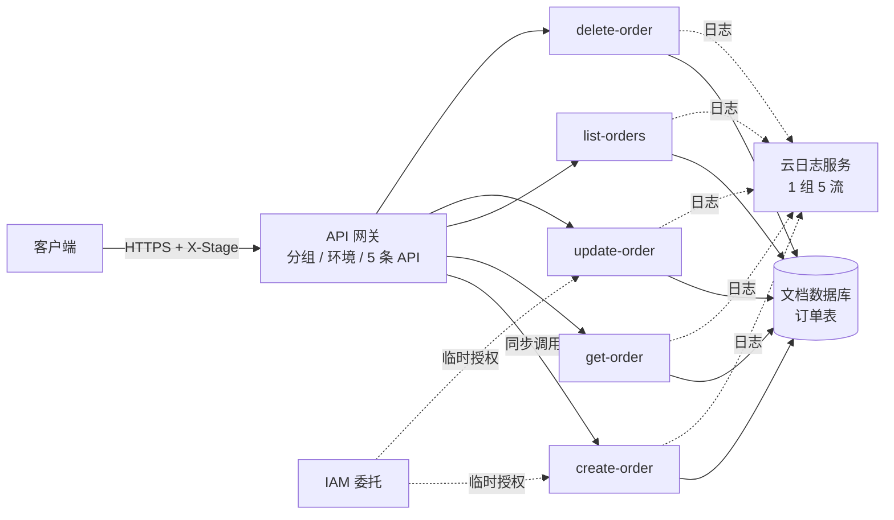

# 基于函数计算与 API 网关的订单 REST 接口实践

[](LICENSE)
[](https://www.huaweicloud.com)

用五个无服务器函数承载订单的创建、查询、列表、更新与删除，经 API 网关对外提供 REST 接口，
订单数据存放在支持兼容接口的文档数据库中。适用于需要一套可直接落地的订单接口骨架、
又不想自己搭服务框架与运维进程的团队。

## 简介

订单接口看起来简单——增删改查而已；但真正上线要处理四件事：请求入口的路由与切换、
函数的冷启动与规格、数据的一致性语义、排障时的日志与追踪。这套实践把四件事拆开成可复用的骨架：

- **入口**：API 网关的分组、环境、五条 API 与发布记录，全部声明式给出；
  非生产环境通过 `X-Stage` 请求头切换，不需要改代码。
- **计算**：五个函数共用一份部署包，只按入口区分。规格收敛到 128 MB / 15 秒，
  因为订单 CRUD 是轻量 IO。
- **数据**：单表承载订单，主键为订单标识；更新用版本号做乐观并发控制，
  版本不符或订单不存在统一返回 409。
- **观测**：显式创建日志组与五条日志流，并在每个函数上绑定日志组与日志流的四个参数——
  少绑一个平台就不会自动建组，日志会静默丢失。

**解决的问题**：把「订单接口从零到可验证」压缩成一次部署，同时保留后续扩展所需的接口边界。

**适用于**：需要快速交付订单类 REST 接口的团队；想用无服务器形态取代常驻服务进程、
又要求接口语义（状态码、分页、并发控制）完整的场景。

## 目录

- [架构图](#架构图)
- [方案亮点](#方案亮点)
- [涉及云服务](#涉及云服务)
- [前置条件](#前置条件)
- [快速开始](#快速开始)
- [分步部署](#分步部署)
- [使用方法与验证](#使用方法与验证)
- [仓库结构](#仓库结构)
- [清理资源](#清理资源)
- [详细说明](#详细说明)
- [常见问题](#常见问题)
- [许可证](#许可证)
- [联系方式](#联系方式)

## 架构图



五个函数共用同一份部署包，仅入口不同；订单表由部署过程创建，销毁时按前缀限定删除范围。

| 层次 | 承担的服务 | 说明 |
|-|-|-|
| 入口 | API 网关专享实例 | 分组 + 环境 + 5 条 API + 发布记录，函数后端、同步调用 |
| 计算 | 函数计算 | 5 个 Java 11 函数，128 MB / 15 秒，ZIP 部署包 |
| 数据 | 文档数据库（兼容接口） | 函数内直连，采用兼容接口的 JSON 协议与请求签名 |
| 观测 | 云日志服务 | 显式日志组与每函数一条日志流，四参数全部绑定 |
| 权限 | 统一身份认证与委托 | 信任云服务身份，授予最小权限的系统角色 |

## 方案亮点

- **接口语义完整**：创建返回 201 与版本号 1；列表按游标分页，每页 10 条；
  更新校验版本号，不符返回 409；删除返回被删除的订单内容；查询不存在返回 404。
- **一份代码五个入口**：五个动作共享模型、数据层与异常映射，部署包只有一个，
  入口由全限定类名区分。
- **确定性构建**：编译用 `javac --release 11`，打包固定条目时间戳与权限，
  同一份源码两次构建的摘要一致，便于比对与复现。
- **日志不丢**：显式建组与建流，并在函数上同时绑定组 ID / 组名 / 流 ID / 流名四个参数。
- **销毁范围可控**：建表与删表都由脚本完成，删除只作用于带本项目前缀的表，
  同一实例上其他项目的数据不受影响。
- **包体自检**：构建脚本校验入口类是否在包内、编译期桩是否被误打入、外层 ZIP 根目录是否只有 `function.jar`。

## 涉及云服务

| 云服务 | 本实践中的职责 | 对应 Terraform 资源 |
|-|-|-|
| 函数计算 | 承载五个订单处理函数 | `huaweicloud_fgs_function` |
| API 网关 | 分组、环境、五条 API 与发布 | `huaweicloud_apig_group`、`huaweicloud_apig_environment`、`huaweicloud_apig_api`、`huaweicloud_apig_api_publishment` |
| 云日志服务 | 一个日志组与五条日志流 | `huaweicloud_lts_group`、`huaweicloud_lts_stream` |
| 统一身份认证服务 | 函数访问云服务的委托 | `huaweicloud_identity_agency` |
| 文档数据库（兼容接口） | 订单持久化 | 由 `terraform_data` 调用建表脚本，不使用声明式资源 |

确认不再需要本实践后，及时释放上述资源，避免残留。

## 前置条件

**账号与权限**

- 已开通账号并完成实名认证，可用区域为 `cn-north-4`（本实践在该区域验证）。
- 具备函数计算、API 网关、云日志服务与统一身份认证的开通与操作权限。
- 具备创建委托的权限：委托需要把角色授予云服务身份，并按项目级挂载。
- 在「我的凭证」页面获取 Access Key ID 与 Secret Access Key，填入部署脚本；
  不要把凭据写入代码或提交到仓库。

**已就绪的外部资源**

- 一个 API 网关专享实例（基础版及以上），记录其实例 ID。
- 一个文档数据库实例（兼容接口），其数据面地址可被函数访问；
  以及一组可访问该实例兼容接口的访问密钥。
- 数据面若为私网地址，需准备网络与子网的 `network_id`，并把函数挂接上去。

**工具与版本**

- Terraform CLI `>= 1.3`，huaweicloud Provider `>= 1.64`。
- JDK 11 及以上（编译函数），Python 3.8 及以上（运行构建与验证脚本）。

**区域与命名约束**

- `var.region` 默认为 `cn-north-4`；数据面签名区域可独立指定，留空则回落到部署区域。
- `var.app_name` 决定全部资源名，须字母开头、可含数字与连字符、长度 3~31。
- 环境名与请求头 `X-Stage` 的取值必须一致；非 RELEASE 环境不带该请求头会返回 404。

## 快速开始

以下命令按顺序执行即可完成一次部署，详细说明见下一节。

```bash
# 1. 构建部署包（离线，不访问任何云端接口）
python src/scripts/build.py

# 2. 本地校验
python src/scripts/run_tests.py
cd infra && terraform init && terraform validate && cd ..

# 3. 填写部署参数并创建资源
cd infra
export HW_ACCESS_KEY=<HW_ACCESS_KEY>
export HW_SECRET_KEY=<HW_SECRET_KEY>
export TF_VAR_apig_instance_id="<APIG 专享实例 ID>"
export TF_VAR_gemini_db_endpoint="<数据面地址>"
export TF_VAR_gemini_access_key="<数据面访问密钥 ID>"
export TF_VAR_gemini_secret_key="<数据面访问密钥 Secret>"
terraform plan -out=jora.tfplan
terraform apply jora.tfplan

# 4. 验证
cd ..
python src/scripts/verify_e2e.py
```

## 分步部署

### 第 1 步：构建部署包

```bash
python src/scripts/build.py
```

预期输出：

```text
[PASS] Java 11 编译完成，编译期 Context 桩未入包
[PASS] function.zip 根目录仅包含 function.jar
[PASS] function.zip sha256=82b724de4feb…
```

产物路径为 `src/build/function.zip`，与 `infra/main.tf` 中 `filebase64` 的取值逐字一致，
因此不需要额外传参。摘要随源码变化，同源码重复构建一致。

### 第 2 步：本地校验

```bash
python src/scripts/run_tests.py
```

预期输出结尾：

```text
passed=22 failed=0
```

```bash
cd infra
terraform init
terraform validate
```

预期输出：

```text
Success! The configuration is valid, but there were some
validation warnings as shown above.
```

未使用官方插件镜像时，警告内容是本地开发覆盖的提示，属预期输出。

### 第 3 步：填写部署参数

必填四项，其余按默认值即可。

```bash
export HW_ACCESS_KEY=<HW_ACCESS_KEY>
export HW_SECRET_KEY=<HW_SECRET_KEY>
export TF_VAR_apig_instance_id="<APIG 专享实例 ID>"
export TF_VAR_gemini_db_endpoint="<数据面地址>"
export TF_VAR_gemini_access_key="<数据面访问密钥 ID>"
export TF_VAR_gemini_secret_key="<数据面访问密钥 Secret>"
```

可选参数（完整清单见 `infra/variables.tf`）：

| 变量 | 默认值 | 说明 |
|-|-|-|
| `region` | `cn-north-4` | 部署区域 |
| `app_name` | `jora-rest` | 资源名称前缀 |
| `apig_env_name` | `prod` | 发布环境名（仅自建环境时生效） |
| `shared_apig_env_id` | 空 | 已有共享环境 ID；非空时不创建环境 |
| `orders_table` | `jora_orders` | 订单表名 |
| `gemini_db_port` / `gemini_db_protocol` / `gemini_db_region` | `8000` / `http` / 空 | 数据面连接与签名 |
| `function_group_id` / `function_network_id` | 空 | 函数挂接的网络与子网，成对填写 |

### 第 4 步：创建资源

```bash
cd infra
terraform plan -out=jora.tfplan
terraform apply jora.tfplan
```

预期输出：

```text
Plan: 25 to add, 0 to change, 0 to destroy.
Apply complete! Resources: 25 added, 0 changed, 0 destroyed.
```

25 个资源包含 1 个日志组与 5 条日志流、1 个委托、5 个函数、1 个建表动作、
1 个分组、1 个环境（使用共享环境时为 0）、5 条 API、5 条发布记录。

### 第 5 步：查看部署输出

```bash
terraform output
```

预期看到 `api_base_url`、`apig_env_name`、`orders_table`、`function_urns` 等输出。
单个值用 `terraform output <输出名>` 获取。

## 使用方法与验证

### 最简示例：创建并查询一笔订单

```bash
export BASE="$(terraform output -raw api_base_url)"

curl -X POST "$BASE/orders" -H "X-Stage: prod" -H "Content-Type: application/json" \
  -d '{"customerId":"c-1","preTaxAmount":100,"postTaxAmount":120}'
```

预期返回 201：

```json
{"orderId":"<订单标识>","customerId":"c-1","preTaxAmount":100,"postTaxAmount":120,"version":1}
```

按标识查询：

```bash
curl "$BASE/orders/<订单标识>" -H "X-Stage: prod"
```

预期返回 200 与同一份订单内容。

### 一次跑完七步校验

```bash
python src/scripts/verify_e2e.py
```

预期输出结尾：

```text
[PASS] 7/7 checks passed
```

七步覆盖：创建（201）、查询（200）、列表（含新订单）、旧版本更新被拒（409）、
更新（版本 2）、删除（返回被删订单）、删除后再查（404）。

### 验证并发控制

先用版本 1 更新一次，使其变为版本 2；再用版本 1 更新同一订单：

```bash
curl -o /dev/null -w "%{http_code}\n" -X POST "$BASE/orders/<订单标识>" \
  -H "X-Stage: prod" -H "Content-Type: application/json" \
  -d '{"customerId":"c-1","preTaxAmount":200,"postTaxAmount":240,"version":1}'
```

预期输出 `409`，返回体：

```json
{"message":"Either the order did not exist or the provided version was not current","statusCode":409}
```

### 验证分页

连续调用列表接口，第一页返回 `lastEvaluatedKey`：

```bash
curl "$BASE/orders" -H "X-Stage: prod"
```

用该值作为游标取下一页：

```bash
curl "$BASE/orders?exclusive_start_key=<lastEvaluatedKey>" -H "X-Stage: prod"
```

最后一页的 `lastEvaluatedKey` 为 `null`。

### 验证日志

```bash
terraform output log_group_id
```

在云日志服务控制台打开该日志组，其下五条日志流分别对应五个函数。
发起任意一次请求后，对应日志流应出现本次调用的记录。

**部署完成后请按本节步骤在真实环境自行验证，确认功能可用后方可视为交付完成。**

## 仓库结构

```text
.
├── README.md
├── README.en.md
├── LICENSE
├── docs/
│   ├── architecture.md          架构组成、数据流与关键设计取舍
│   └── deployment-guide.md      分步部署命令与每步预期输出
├── infra/
│   ├── versions.tf              Terraform 与 Provider 版本约束
│   ├── variables.tf             输入变量
│   ├── main.tf                  函数、入口、日志、委托与表的生命周期
│   └── outputs.tf               对外输出
└── src/
    ├── main/java/com/example/jora/
    │   ├── handler/             五个处理程序与事件、响应装配
    │   ├── db/                  数据层与兼容接口客户端
    │   ├── model/               请求与响应模型
    │   └── exception/           业务异常
    ├── test/java/com/example/jora/tests/   单元测试与数据层替身
    ├── scripts/
    │   ├── build.py             确定性打包
    │   ├── run_tests.py         编译并驱动单元测试
    │   ├── ensure_table.py      建表与删表
    │   └── verify_e2e.py        部署后端到端校验
    └── build/                   构建产物（构建生成）
```

## 清理资源

```bash
cd infra
terraform destroy
```

预期输出：

```text
Destroy complete! Resources: 25 destroyed.
```

销毁会删除函数、分组/环境/API/发布、日志组与日志流、委托，并调用建表脚本的删除分支。
删除只作用于带本项目前缀的表。网关专享实例与文档数据库实例属外部资源，
不在本目录的清理范围，需按各自流程处理。

## 详细说明

- 架构组成、端到端数据流与关键设计取舍：[docs/architecture.md](docs/architecture.md)
- 从零到可验证部署的完整命令与预期输出：[docs/deployment-guide.md](docs/deployment-guide.md)
- 英文版说明：[README.en.md](README.en.md)

## 常见问题

**函数报「找不到入口」。**
部署包外层 ZIP 的根目录必须只有 `function.jar`，入口写全限定类名加点号与 `handleRequest`。
用 `python src/scripts/build.py` 生成的包满足这一点。

**调用返回 404 但路径是对的。**
非 RELEASE 环境必须带 `X-Stage` 请求头，取值等于部署输出里的 `apig_env_name`。

**更新一直返回 409。**
版本号已过期。先查询取当前版本号，再带该版本号更新。订单不存在时同样返回 409。

**首次调用超时。**
Java 冷启动较慢，重试即可。持续超时则检查函数超时配置（默认 15 秒）与数据面连通性。

**日志为空。**
五个函数必须同时绑定日志组 ID / 名称与日志流 ID / 名称四个参数；
只开日志开关不绑参数时平台不会自动建组。

**建表失败。**
核对数据面地址与端口可达性；私网地址需要把函数挂接到同一网络（成对提供网络与子网变量）。

**销毁后表还在。**
删除只作用于带本项目前缀的表。表名不以该前缀开头时不会被删除，需手工处理。

## 许可证

本实践采用 MIT No Attribution 许可证发布，详见 [LICENSE](LICENSE)。

## 联系方式

创建与维护团队：公有云持续运营部。

使用中遇到问题请在本仓库提交议题，我们会定期查看。
