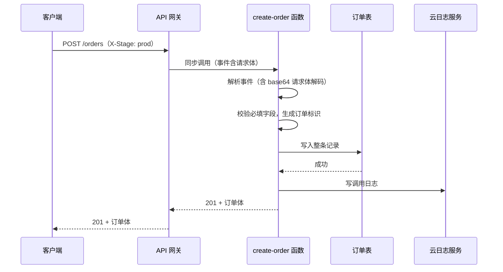
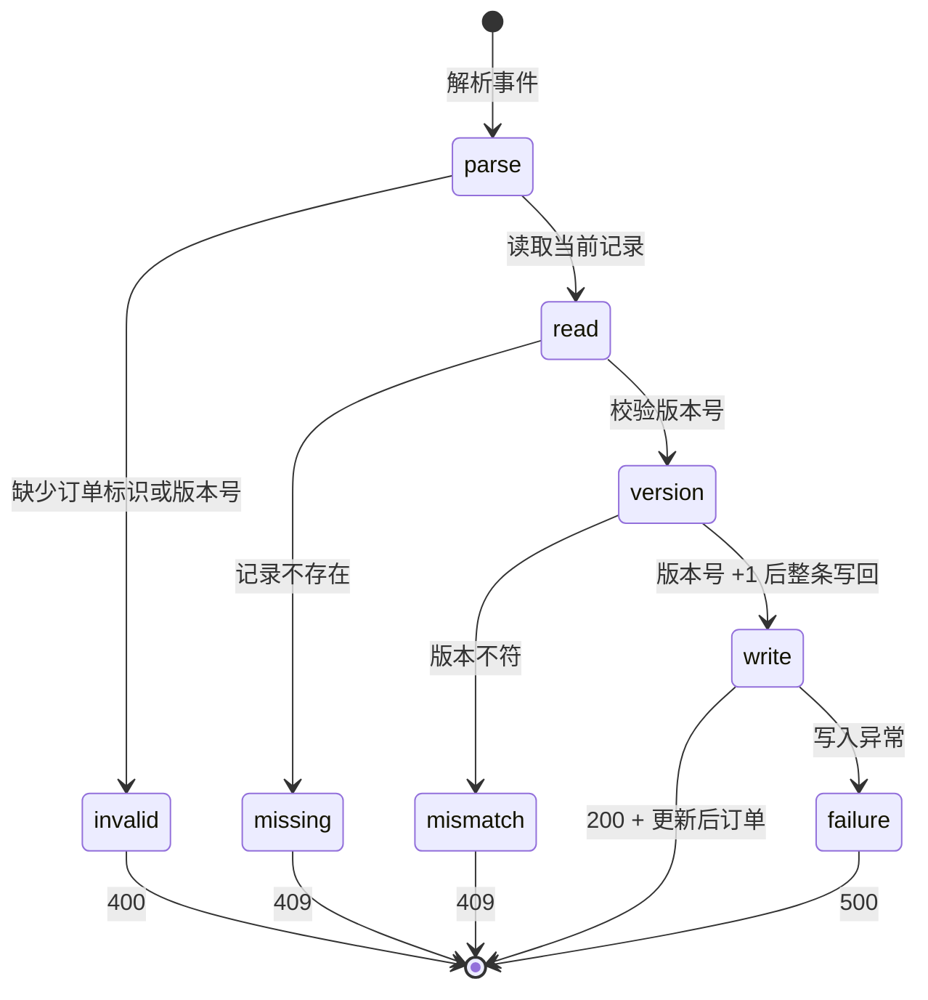
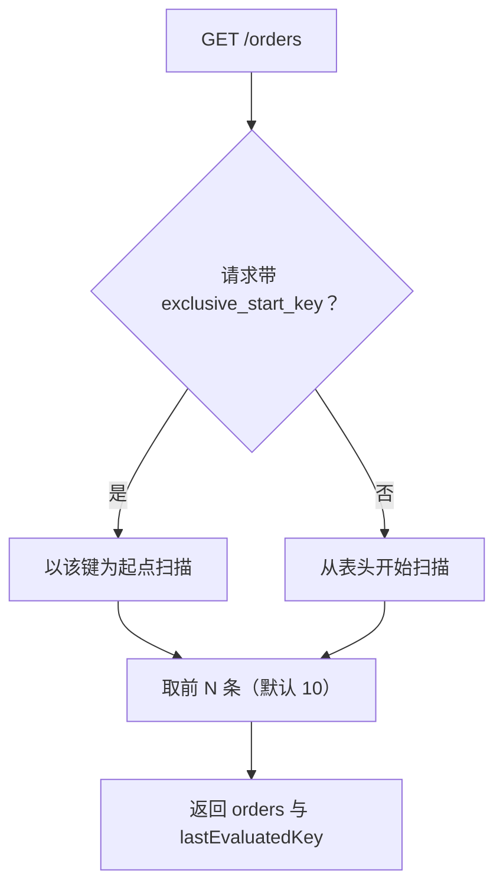

# 架构与技术设计

本文说明本实践的架构组成、端到端数据流与关键设计取舍。
部署命令见 [deployment-guide.md](deployment-guide.md)，功能概览见仓库根目录 `README.md`。

## 1. 分层与职责

| 层 | 职责 | 落地位置 |
|-|-|-|
| 入口层 | 对外暴露 HTTP 路由，把请求转发到函数并回传响应 | `infra/main.tf` 的分组、环境、API 与发布记录 |
| 计算层 | 承载订单的业务规则：创建、查询、列表、更新、删除 | `src/main/java/com/example/jora/` 五个处理程序 |
| 数据层 | 订单的持久化与分页查询 | `src/main/java/com/example/jora/db/` |
| 观测层 | 函数运行日志与调用排障 | `infra/main.tf` 的日志组与五条日志流 |
| 权限层 | 函数访问云服务所需的委托与角色 | `infra/main.tf` 的委托资源 |

## 2. 组件清单

### 2.1 函数（`infra/main.tf`）

| 组件 | 配置要点 |
|-|-|
| `create-order` | 入口 `com.example.jora.handler.CreateOrderHandler.handleRequest` |
| `get-order` | 入口 `com.example.jora.handler.GetOrderHandler.handleRequest` |
| `list-orders` | 入口 `com.example.jora.handler.GetOrdersHandler.handleRequest` |
| `update-order` | 入口 `com.example.jora.handler.UpdateOrderHandler.handleRequest` |
| `delete-order` | 入口 `com.example.jora.handler.DeleteOrderHandler.handleRequest` |

五个函数共用同一份部署包 `src/build/function.zip`，运行时为 Java 11，内存 128 MB，超时 15 秒，
仅入口不同。部署包外层 ZIP 的根目录只有 `function.jar`，编解码依赖按类并入，编译期运行时上下文桩不进入包。

### 2.2 入口（`infra/main.tf`）

- 1 个分组（开启调试子域名）、1 个环境（默认 `prod`）与 5 条 API、5 条发布记录。
- 后端类型为函数计算，版本 `latest`，同步调用，网关侧超时 15 秒。
- 非 RELEASE 环境由请求头 `X-Stage` 指定；API 侧未设鉴权。

| 方法 | 路径 | 函数 |
|-|-|-|
| POST | `/orders` | create-order |
| GET | `/orders/{order_id}` | get-order |
| GET | `/orders` | list-orders |
| POST | `/orders/{order_id}` | update-order |
| DELETE | `/orders/{order_id}` | delete-order |

### 2.3 数据（`src/scripts/ensure_table.py`）

订单表以 `orderId` 为主键（HASH）。表由 `terraform_data` 在应用阶段调用建表脚本创建，
脚本轮询到表可用后返回；销毁阶段调用同一脚本的删除分支，且只删除带本项目前缀的表，
共享实例上其他项目的表不受影响。

访问路径为兼容接口的 JSON 协议：请求头带 `X-Amz-Target` 指向具体操作，
请求体为标准 JSON 文档，签名采用区域、服务名与时间派生的四段式凭据作用域。

### 2.4 观测与权限

- 1 个日志组与 5 条日志流（每个函数一条），函数侧绑定日志组 ID/名称与日志流 ID/名称四个参数；
  未绑定全部四参数时平台不会自动建组，日志会丢失。
- 1 个委托，信任云服务身份，授予日志读写角色；函数挂接共享网络时追加网络只读角色。
  数据面凭据由部署参数下发，不进入委托。

## 3. 端到端数据流

### 3.1 一次创建订单的完整时序

### 3.2 更新订单的状态机

### 3.3 列表分页

### 3.4 云侧调用面

函数对数据面的调用收口在一个客户端类内，端点、端口、协议与签名区域全部来自运行期配置：

| 操作 | 用途 | 重试 |
|-|-|-|
| GetItem | 单条读取（查询、更新前校验、删除前取旧值） | 不重试 |
| PutItem | 创建与整条写回 | 不重试 |
| DeleteItem | 删除 | 不重试 |
| Scan | 列表分页 | 不重试 |

## 4. 运行期配置契约

函数的环境配置只取 `infra/main.tf` 中 `local.function_env` 已声明的键，代码侧不新造键名。

| 键 | 来源 | 用途 |
|-|-|-|
| `TABLE_NAME` | `var.orders_table` | 订单表名 |
| `PAGE_SIZE` | 固定 `10` | 列表每页条数 |
| `GEMINI_ENDPOINT` | `var.gemini_db_endpoint` | 数据面地址 |
| `GEMINI_PORT` | `var.gemini_db_port` | 数据面端口 |
| `GEMINI_PROTOCOL` | `var.gemini_db_protocol` | `http` 或 `https` |
| `GEMINI_REGION` | `var.gemini_db_region`，留空回落到 `var.region` | 签名区域 |
| `GEMINI_ACCESS_KEY` / `GEMINI_SECRET_KEY` | 敏感变量 | 数据面凭据 |

## 5. 关键设计取舍

### 5.1 为什么五个入口共用一个部署包

订单的五个动作共享模型、数据层与异常映射，拆成五个包会让同一份代码重复五次。
同一份 `function.jar` 配五个入口，既保留「一动作一函数」的独立伸缩与独立日志，
又只维护一份实现。

### 5.2 为什么乐观锁不采用原子条件更新

数据面的兼容接口在部分部署形态下对条件表达式的支持需要逐版本确认。
为让行为在验证环境中可复现，更新改为「读取 → 校验版本 → 整条写回（版本 +1）」，
对外语义完整保留：版本不符或订单不存在返回 409，成功返回版本递增后的全量订单。
代价是读与写之间没有原子条件，同一版本的并发更新存在竞态窗口——这在低并发的样例场景可接受，
生产场景应引入条件写能力后再评估。

### 5.3 为什么删除要先读后删

删除接口需要返回被删除的订单内容。若依赖「删除并返回旧值」的单次调用，
在兼容接口上的可用性需逐版本确认；改为先读后删后，行为确定且 404 语义清晰。
原「并发竞争导致删除失败」的分支在无条件下不可达，对应异常类型保留但不再触发。

### 5.4 为什么表由脚本创建而不是声明式资源

订单表建在共享实例上，实例本身由外部基础设施统一创建并复用。
用 `terraform_data` 调用建表脚本可以把「建表 / 删表」纳入同一份状态，
同时把删除范围限定在带本项目前缀的表，避免误删同实例上其他项目的数据。

### 5.5 为什么日志要显式建组与流

函数若只开启日志开关而不绑定日志组与日志流的四个参数，平台不会自动建组，
日志会静默丢失。因此 `infra/main.tf` 显式创建 1 个日志组与 5 条日志流，
并在每个函数上同时绑定 ID 与名称。

### 5.6 为什么委托不承载数据权限

数据面的凭据是账号级访问密钥，不属于委托可承载的临时授权范畴。
把数据权限从委托中剥离后，委托只覆盖日志与可选的网络挂接，
权限面更小，且数据面凭据可独立轮换。

### 5.7 为什么构建链改为离线脚本

构建机没有 Maven 环境。`src/scripts/build.py` 用 `javac --release 11` 编译并做确定性打包
（固定条目时间戳与权限），两次构建产物摘要一致；`src/scripts/run_tests.py` 编译并驱动单元测试。
这样在无网络、无包管理器的环境里也能复现同一份部署包。

## 6. 扩展点

- **换表名或数据面**：改 `var.orders_table` 与 `var.gemini_*` 系列变量，无需改代码。
- **加字段**：在 `src/main/java/com/example/jora/model/Order.java` 增加字段，
  并在处理程序的必填校验中同步。
- **加路由**：在 `local.api_routes` 增加一项，并为它指向的函数补一个入口类。
- **收紧规格**：内存与超时在 `infra/main.tf` 的五个函数上统一调整。
- **接入鉴权**：把 `security_authentication` 从 `NONE` 改为应用认证，并在网关侧配置凭据。
